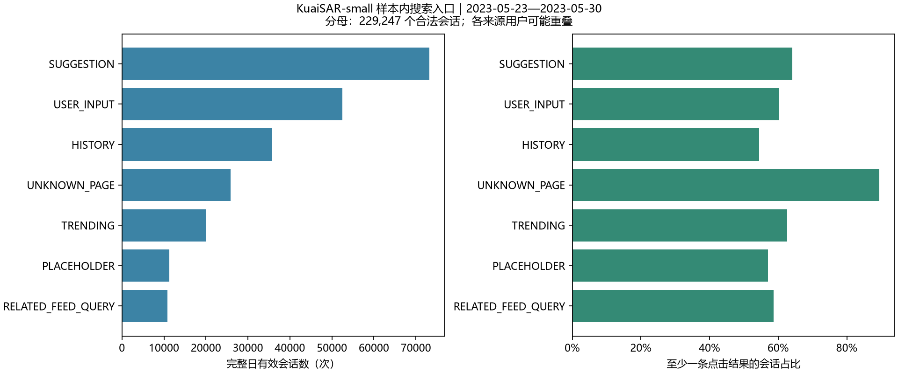
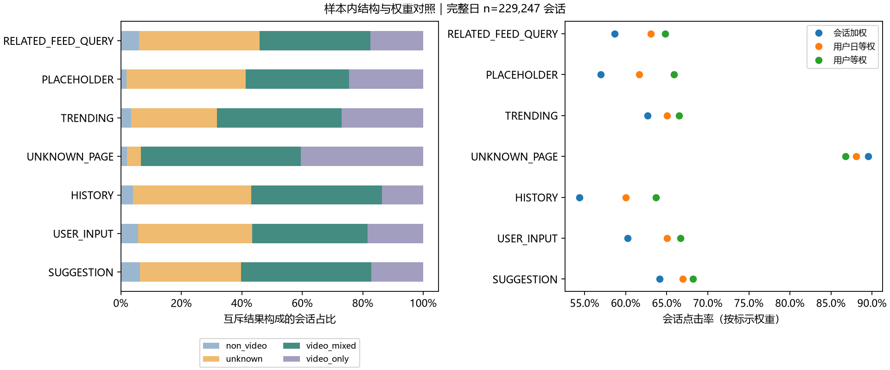
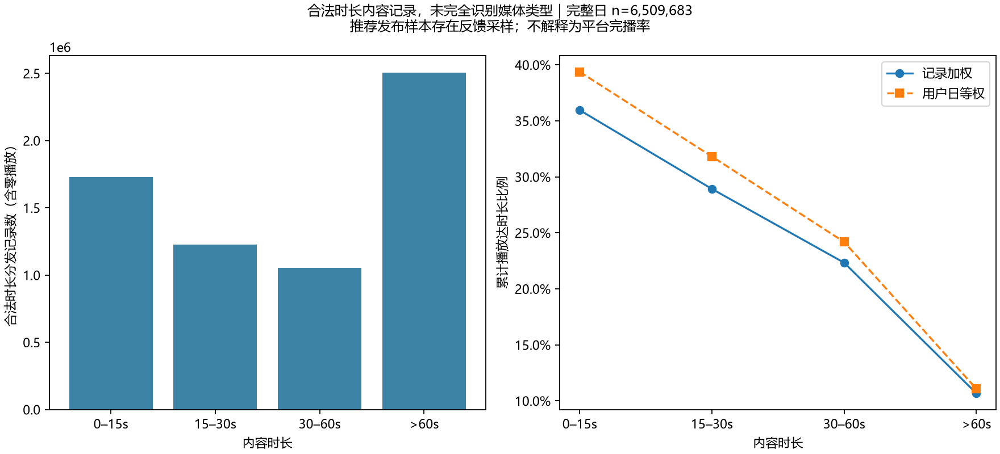
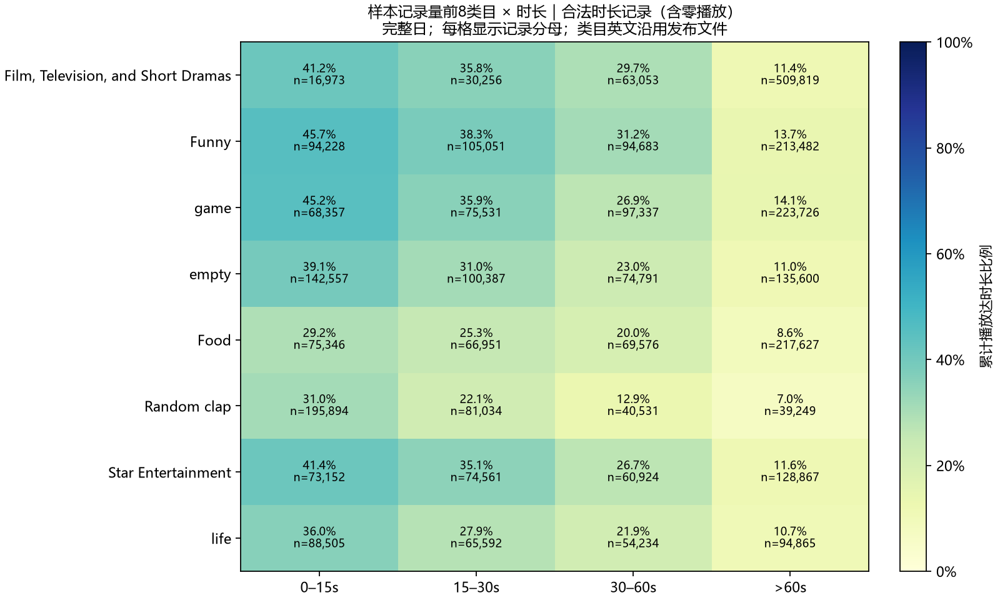

# 项目总结

## 一、问题、范围与主要结论

目标是在样本内筛出值得核查的搜索差异，补充内容消费描述，并形成可复现的求职作品。完整日中，按会话量选择的 SUGGESTION 与 USER_INPUT 分别有 73,156、52,500 个会话，点击率 64.15%、60.26%，前者减后者为 3.89 个百分点。共同日期×互斥结果类型×公开搜索活跃层级标准化后，差异为 -0.18 个百分点。 严格口径因click_cnt非二元而隔离 16,272 个会话；若仅在独立敏感性情形中假定正整数表示有点击，两来源差异为 3.65 个百分点。主结果仅适用于符合官方二元字段约定的会话，排除会话可能带来选择偏差。

合法时长内容记录中，0–15s 组累计播放达时长比例为 35.95%，>60s 组为 10.66%。时长与结果明显相关，类目对照必须放在同一时长层内。

两张行为表共 10,664,332 行；用户维表 25,877 人。合法搜索会话 251,336 个，16,272 个会话被排除；缺键行 0。搜索完整日会话 229,247 个。维表人数、两张日志去重人数、合法搜索人数是不同口径；未在该阶段获得合法搜索的维表用户数为 155。

实际文件规模、原始字段缺失、重复哈希、时间核对分别见 `outputs/audit/data_inventory.csv`、`field_profile.csv`、`quality_report.json`。哈希诊断保留完全相同记录，不据此删除。用户维度真实字段 `reco_active_level` 与网页拼写不同；脱敏特征的取值也不强套网页示例范围。

## 二、搜索粒度与入口概览

搜索结果行不是搜索次数。会话键为 `(user_id, search_session_id)`，有至少一条合法点击即计入点击会话。任一行点击不合法、来源缺失／冲突或时间缺失／冲突时隔离整个会话；排除会话保存在审计表。合法会话保存在Parquet，用户日表单独保存。

| source | users | sessions | session_share | session_click_rate | no_click_rate |
| --- | --- | --- | --- | --- | --- |
| SUGGESTION | 18008 | 73156 | 0.319114 | 0.641465 | 0.358535 |
| USER_INPUT | 14711 | 52500 | 0.229011 | 0.602590 | 0.397410 |
| HISTORY | 10927 | 35694 | 0.155701 | 0.543705 | 0.456295 |
| UNKNOWN_PAGE | 8158 | 25824 | 0.112647 | 0.895252 | 0.104748 |
| TRENDING | 7537 | 19941 | 0.086985 | 0.626448 | 0.373552 |
| PLACEHOLDER | 4697 | 11322 | 0.049388 | 0.569511 | 0.430489 |
| RELATED_FEED_QUERY | 5058 | 10810 | 0.047154 | 0.586679 | 0.413321 |

正式比较门槛固定为100会话和30用户，仅用于显示规模判断，不代表显著性。小来源全部保留；分组人数不可求和当总人数。完整日以外的数据见 `search_source_all_dates.csv` 和 `search_daily.csv`。

## 三、结构、权重与替代解释

完整日中，按会话量选择的 SUGGESTION 与 USER_INPUT 分别有 73,156、52,500 个会话，点击率 64.15%、60.26%，前者减后者为 3.89 个百分点。共同日期×互斥结果类型×公开搜索活跃层级标准化后，差异为 -0.18 个百分点。 严格口径因click_cnt非二元而隔离 16,272 个会话；若仅在独立敏感性情形中假定正整数表示有点击，两来源差异为 3.65 个百分点。主结果仅适用于符合官方二元字段约定的会话，排除会话可能带来选择偏差。 选择两大来源是因为规模充分，且避免事后挑最好最差的极端值。

会话互斥分为纯VIDEO、含VIDEO混合、不含VIDEO和未知，未知类型不强制归入视频。行级类型关联率另存审计表，不与会话率混用。

| source | sessions | users | session_click_rate | user_day_equal_click_rate | user_equal_click_rate |
| --- | --- | --- | --- | --- | --- |
| SUGGESTION | 73156 | 18008 | 0.641465 | 0.669606 | 0.681634 |
| USER_INPUT | 52500 | 14711 | 0.602590 | 0.650530 | 0.666629 |
| HISTORY | 35694 | 10927 | 0.543705 | 0.599894 | 0.636993 |
| UNKNOWN_PAGE | 25824 | 8158 | 0.895252 | 0.880484 | 0.867509 |
| TRENDING | 19941 | 7537 | 0.626448 | 0.650078 | 0.664833 |
| PLACEHOLDER | 11322 | 4697 | 0.569511 | 0.616488 | 0.658574 |
| RELATED_FEED_QUERY | 10810 | 5058 | 0.586679 | 0.630780 | 0.648324 |

用户日等权先算每个来源×用户×日的点击会话比例，再平均。活跃天多的用户仍可贡献多次，因此另列用户等权；三者目标统计对象不同，不能挑一个有利口径。完整日 8/8 天两大来源差异同方向，日期对照不构成随机对照。

| source | common_strata | common_sessions | common_support_fraction | common_raw_rate | standardized_click_rate |
| --- | --- | --- | --- | --- | --- |
| SUGGESTION | 206 | 73141 | 0.999795 | 0.641473 | 0.624552 |
| USER_INPUT | 206 | 52490 | 0.999810 | 0.602610 | 0.626323 |

标准化只保留两来源都有会话的日期×互斥结果类型×公开搜索活跃度层，以两来源在共同层的合计会话数作为同一权重；报告覆盖比例及共同层原始率，避免把失去支持的会话静默纳入比较。稀疏层和未观测意图仍限制解释。活跃层级是发布者按过去一个月活跃天数得到的公开标签，非本项目预测特征；公开说明未给出逐用户计算时点。

`click_cnt`真实含大于1的值，与官方是否点击描述不一致，不能直接求和当点击次数。严格主分析保留0/1完整会话；独立正值敏感性情形不是已确认修正规则。各入口排除比例见 `search_exclusions_by_source.csv`，敏感性比例见 `search_positive_click_sensitivity.csv`。不把严格样本率当全体搜索率。

在相同可观测结构权重下，原始来源优势没有保持；这支持先核查结果组成与样本结构，而非据原始率决定入口改版。仍不能排除未观测意图或稀疏层的影响。

## 四、内容消费专题（合法时长内容）

无法完整识别视频和图文，按规划降级为合法时长内容记录。毫秒单位依据官方字段及人类时间逐行核对。合法时长要求duration有限且>0、playing_time有限且≥0，零播放进入分发分母；另存实际播放>0的分母。内容表同名类型重命名为content_item_type，不将NORMAL当视频。少量类型属性混入文本，标为未核实，不据此推断媒体；记录数和政策见quality_report的item_attribute_warning。类目ID与英文名保留。

完整日合法记录 6,509,683，原始全期非法时长记录 279,629；零时长 279,629、负播放 0（这些诊断可能重叠，不相加）。关联未知类目保留为UNMATCHED。关联前后行数、用户数及播放、时长、点赞、关注合计通过核对。

| duration_band | rows | users | duration_median_ms | mean_play_ratio | median_play_ratio | p90_play_ratio | capped_play_ratio | reaches_duration_rate | exceeds_duration_rate | like_rate | follow_rate | played_rows | user_like_rate | user_day_equal_reaches_rate | user_day_equal_capped_ratio | user_day_equal_like_rate |
| --- | --- | --- | --- | --- | --- | --- | --- | --- | --- | --- | --- | --- | --- | --- | --- | --- |
| 0–15s | 1727782 | 24993 | 10766.000000 | 0.940190 | 0.582238 | 2.028663 | 0.582812 | 0.359506 | 0.359471 | 0.030271 | 0.004233 | 1679729 | 0.312007 | 0.393680 | 0.595367 | 0.040440 |
| 15–30s | 1224928 | 24870 | 19233.000000 | 0.647203 | 0.353509 | 1.373050 | 0.493132 | 0.289145 | 0.289115 | 0.031630 | 0.004404 | 1193587 | 0.300201 | 0.318094 | 0.507519 | 0.041905 |
| 30–60s | 1051980 | 24699 | 42466.000000 | 0.474605 | 0.196633 | 1.079295 | 0.414023 | 0.223272 | 0.223253 | 0.031472 | 0.004915 | 1021696 | 0.270821 | 0.241785 | 0.418855 | 0.040056 |
| >60s | 2504993 | 25326 | 152960.000000 | 0.276428 | 0.057620 | 1.004464 | 0.262502 | 0.106600 | 0.106594 | 0.030038 | 0.004978 | 2396529 | 0.388257 | 0.110652 | 0.256657 | 0.038770 |

合法时长内容记录中，0–15s 组累计播放达时长比例为 35.95%，>60s 组为 10.66%。时长与结果明显相关，类目对照必须放在同一时长层内。 原始比例保留大于1的值，可能包含重复播放；封顶比例只是辅助统计。均值、中位数、P90与全局分位数分别见内容汇总和 `playback_distribution.csv`，不可将均值等同典型用户。

同一宽时长箱内仍有时长分布残差，`content_category_duration.csv` 保留时长中位数用于核查。类目表全部保留；图只按记录量选择前8类，不按表现挑选。对照是观察性描述，不推荐据此增加某类目流量。

## 五、核验与下一步

SQLite在会话表上独立计算每来源人数、会话数、点击会话数、结果行数、点击行数及点击率，与Pandas一致。200名固定用户完整日志的整表筛选与分块筛选后统一聚合一致。边界测试覆盖点击缺失、来源冲突、缺键、重复维度、时长边界；正式运行逐次校验维度唯一性、关联合计和会话行数守恒。见 `outputs/audit/quality_report.json`。

优先核对两大来源的产品语义、自动播放与反馈测量。新增可信满意度指标、曝光位置与查询难度代理后，才讨论策略实验。后续方案见《后续实验设计》，没有真实上线或收益估算。模拟案例见《实验分析练习》，不能解释本节真实日志差异。

本项目是公开选择样本的观察分析；无点击不等于不满意，自动播放可能满足需求。来源编码仅沿用原值；用户意图、查询难度与排序位置未充分观测。推荐点击正负样本经过构建，不估算平台CTR或增长空间。内容媒体类型未完整识别，累计播放达时长也不等于一次连续完播。匿名特征不解读成人口属性。

## 六、数据来源

[官方字段说明](https://ethan00si.github.io/KuaiSAR/detailed_statistics.html)、[官网](https://kuaisar.github.io/)、[Zenodo正式small包](https://zenodo.org/records/8181109)。版本、摘要、范围和配置见 `data/manifest.json`。未追加P2网站、模型或在线实验。
